# Investigating the behaviour of a supply-chain backdoor - Sunburst

## Introduction
Discovered in December 2020, the trojanized supply chain attack Sunburst has affected 18.000 public and private organizations between March and June 2020. The backdoor was ditributed via digitally signed software updates for the SolarWinds Orion platform and has managed to breach nine U.S. federal agencies along with elite private sector companies. 

Sunburst has outstanding evasion capabilities, along with a dormant period of up to two weeks after instalation. It uses a Domain Generation Algorithm to disguise C2 connection as legitimate API communications and allows remote commands.

## Static analysis
The first step was calculating the MD5 hash of the file using Powershell's `Get-FileHash` function.
**Original File Name:** 32519b85c0b422e4656de6e6c41878e95fd95026267daab4215ee59c107d6c77.exe
**MD5 Hash:** B91CE2FA41029F6955BFF20079468448 
**SHA1 Hash:** 76640508B1E7759E548771A5359EAED353BF1EEC 
**SHA256 Hash:** 32519B85C0B422E4656DE6E6C41878E95FD95026267DAAB4215EE59C107D6C77 
**File Type:** PE32 executable dll 
**Size:** 10111032 bytes 
**Entropy:** 5.583 
**Compiler timestamp:** Tue Mar 24 08:52:34 2020 (UTC)
**Used libraries:** 1 (mscoree.dll - Microsoft .NET Runtime Execution Engine)
**Imports:** 1 (_CorDllMain - initializes CLR and locates entry points)
**Entry point:** 0x000F61A6 

Next I submitted the Hash to Cuckoo. It appears as suspicious and 8 Yara rules are detected for it. 

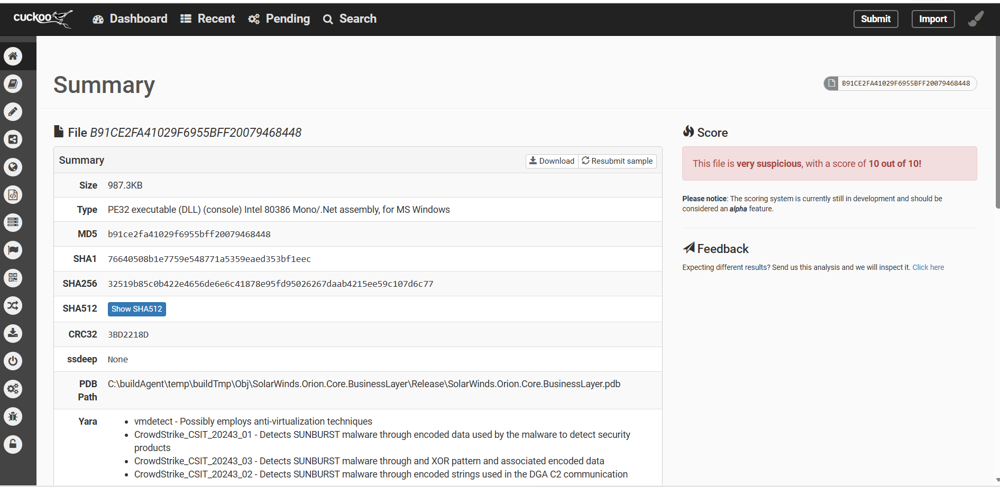

Virus Total also finds the file suspicious with 60/70 detections.  In terms of relations, there are 4 execution parents, 1 resource child and 4 bundled files.

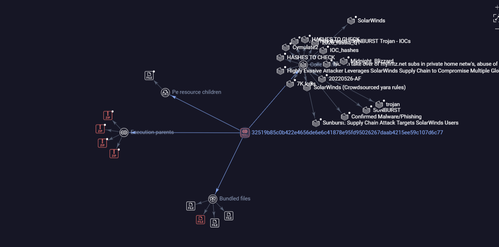

Interesting fact is that the last seen date is 24-06-2026.

Next I analyzed the file in PE Studio
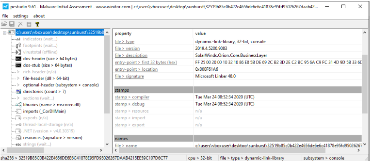
Under resources there is only a signature version. 

Next I opened the file in CFF Explorer:
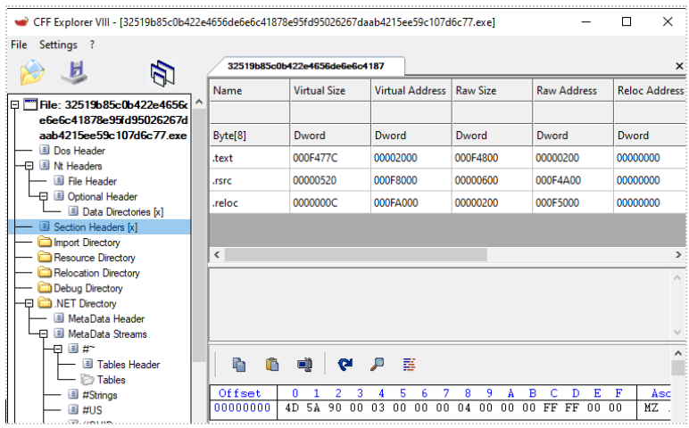

The file consists of three sections:

| Section | Entropy | File Ratio |
|---|---|---|
| **.text** | 5.569 | 99.05% |
| **.rsrc** | 3.016 | 0.15% |
| **.reloc** | 0.102 | 0.05% |

We notice the text section contains most of the content and the entropy is expected in compiled code, but it does not rule out obfuscation. Next I compared the virtual and raw sizes in order to determine whether the file is packed:

| Section | Virtual Size | Raw Size | 
|---|---|---|
| **.text** | 978.85 KB | 978.98 KB | 
| **.rsrc** | 1.28 KB | 1.5 KB |
| **.reloc** | 12 B | 512 B | 

There is no significant difference between the virtual and raw sizes in the .text and .rsrc sections, suggesting the executable is not packed.

No packer was identified by PEID either:
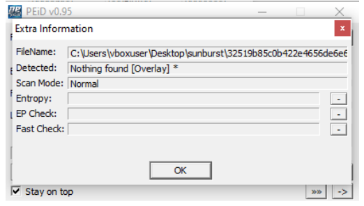

String and floss analysis reveal some interesting urls related to SolarWinds corporate website and Symantec certificate infrastructure, but no other significant information.

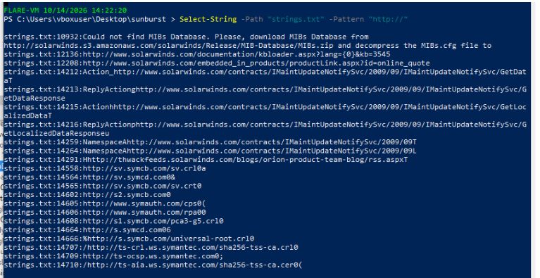

Capa has found significant capabilities in the pe, distributed against 6 Att&cK Tactics.

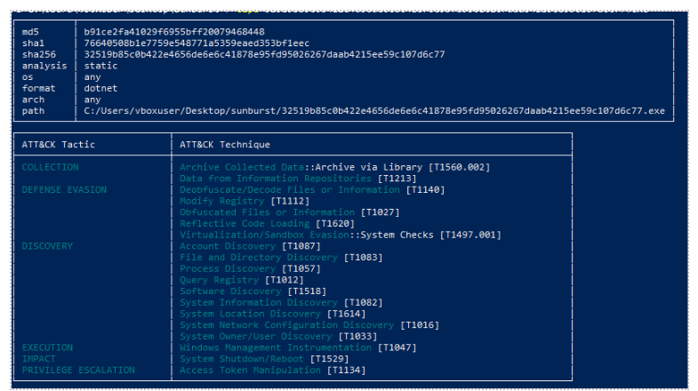

Classified by MBC objectives, there are Anti-Behavioural Analysis, Command and Control Comuunication, Cryptography, Data, Defense evasion, Discovery, File system, Operation system and process capabilities.

## Reverse engineering
Because we know the file has .NET related imports, I used ILSpy to decompile it and see what catches my attention. Sure enough, in `SolarWinds.Orion.Core.BusinessLayer.OrionImprovementBusinessLayer.ProcessTracker` we find a function that searches through the active processes and compares them to a list of hardcoded hashes:

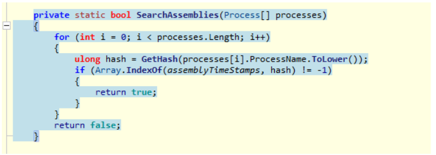

The name `assemblyTimeStamps` is meant to deceive, because the array does not contain timestamps, but 137 hashes:

`private static readonly ulong[] assemblyTimeStamps = new ulong[137] {2597124982561782591uL, 2600364143812063535uL, ...}`

The GetHash function uses a variant of FNV-1a 64-bit hashing, followed by an XOR with a constant. We recognize it by the definition of num which is standard FNV-1a 64-bit offset basis.

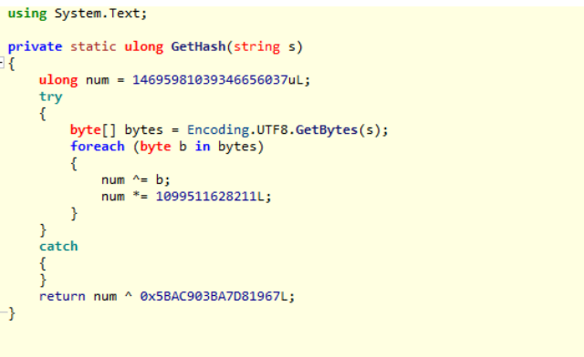

Since the hashes are not directly reversible, we can try candidate based hash matching.

For this I built a script that takes a candidates list comprised of lowercase process names - including both windows processes and known debuggers, malware analysis utilities and virtualization processes, hashes them and compares them to the initial assemblyTimeStamps array. The script managed to identify 27 processes from a list of 160 candidates:

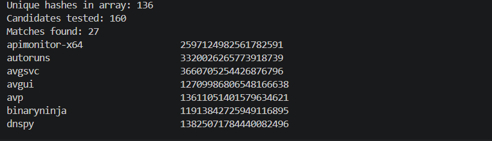

Floss, FakeNet, PEStudio, Wireshark and VBoxService are related to defence evasion. However, elasticsearch and inetsim seem to not be on the list. 

Next, in order to see what really sets the checks off from my setup, I used the following powershell command to get a list of currently running processes on my Flare machine:

`@echo off
powershell -NoProfile -Command "Get-Process | Select-Object -ExpandProperty ProcessName | ForEach-Object { $_.ToLower() } | Set-Content -Encoding utf8 '%~dp0running_processes.txt'"`

This resulting in a list of my open processes, but even with no application running, the vboxservice process was flagged among the hashes.

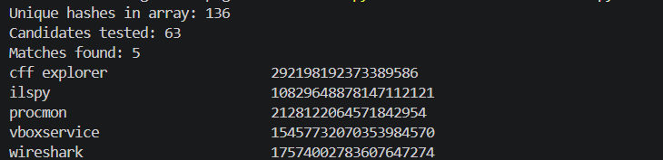

For control, I ran the same powershell script on a regular Windows installation and compared the list of processes with the hashes. Nothing was flagged in this case.

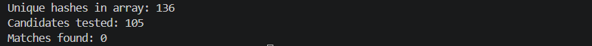

## Dynamic analysis
Since the malware has a dormant period and employs multiple evasion techniques, the approach for the dynamic analysis should take them into account and address them before detonation. 

At this stage, this is WIP. 
  

  
